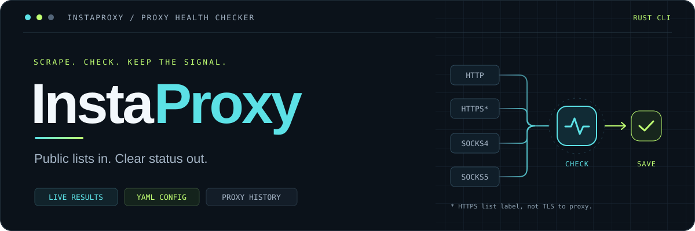

<div align="center">
<a id="top"></a>



### Public lists in. Clear status out.

**A colorful Rust CLI for scraping public proxy lists and checking their health.**  
HTTP · HTTPS-labelled · SOCKS4 · SOCKS5  
Live per-proxy logs · animated console counters · timestamped exports · reusable history

[](#build-from-source)
[](config.yaml)
[](source.txt)
[](#live-output)
[](LICENSE)

[Quick start](#quick-start) · [Commands](#commands) · [Configuration](#configuration) · [Sources](#sources) · [Results](#results-and-history) · [Troubleshooting](#troubleshooting)

</div>

---

> [!IMPORTANT]
> **Health checks, not a trust guarantee.** `ALIVE` means the proxy handshake succeeded; it does not verify end-to-end HTTP content, TLS, anonymity, or the operator's trustworthiness. Authentication-required proxies are excluded from checked results. Credentials are never attempted.

## What you get

| Collect | Check | Keep |
|:---|:---|:---|
| **18 editable raw sources** across six GitHub repositories | **Four protocol labels**, with configurable concurrency | Separate **HTTP / HTTPS / SOCKS4 / SOCKS5** files |
| Source availability reports with readable URLs | One colored log line **as each check finishes** | Timestamped run folders and status summaries |
| Deduplicated endpoints and configurable list limits | **ALIVE · SLOW · DEAD · TIMEOUT · AUTH REQUIRED** | Successful endpoints merged into **`history.txt`** |
| Optional local input and previous history | Animated title with live counters and a progress heartbeat | Slow-proxy list; dead, timeout, and auth entries excluded |

**One executable. One YAML file. Three workflows.** No account or API key required by the app.

```text
                           ┌─ scrape ───────────────► unverified snapshots
source.txt ──► public lists ┤
                           └─ scrape-check ─┐
                                           ├──► live checks ──► results + history
proxies.txt + history.txt ──────── check ────┘
```

`Scrape + Check` also includes configured local input and enabled history. `Scrape` does not perform proxy checks or update history.

## Quick start

### Run the Windows portable build

If you have the **`InstaProxy-v0.1.0-windows-x64.zip`** bundle:

1. Extract the **entire** archive into a writable folder, separate from the source project.
2. Keep the executable, `config.yaml`, and `source.txt` together.
3. Double-click **`Start-InstaProxy.bat`**. It keeps the window open after the app exits.
4. Pick an operation from the menu.

```text
InstaProxy/
├── instaproxy.exe        ← compiled release; no Rust installation needed
├── Start-InstaProxy.bat  ← double-click launcher
├── config.yaml          ← timeouts, concurrency, protocols, paths
├── source.txt           ← one raw source URL per line
├── START-HERE.txt
├── README.md
├── LICENSE
└── docs/assets/          ← README banner
```

The Windows executable is unsigned. Only run binaries from a source you trust. The portable launcher is part of the ZIP, not an output of the source build scripts.

### Build from source

Install [current Rust stable](https://rustup.rs/), including Cargo and `rustfmt`. On Windows with the MSVC toolchain, install **Visual Studio Build Tools → Desktop development with C++** and a Windows SDK.

From the source project folder:

```powershell
.\build.bat
.\target\release\instaproxy.exe
```

The build script locates Cargo, formats the source, runs the tests, and builds with the lockfile. The executable is created at **`target/release/instaproxy.exe`**, not at the project root.

<details>
<summary><strong>Linux / macOS and manual Cargo builds</strong></summary>

With Rust stable and your platform's native C/C++ build tools installed:

```sh
sh build.sh
./target/release/instaproxy
```

To build without the scripts' formatting and test steps:

```sh
cargo build --release --locked
```

Windows is the locally verified platform. These are the standard Unix build paths, not a claim of Linux/macOS release testing.

</details>

### Choose your workflow

| Menu | Command | What happens |
|:---:|:---|:---|
| **1** | `scrape-check` | Fetch lists, merge local input/history, check candidates, save successful endpoints |
| **2** | `scrape` | Fetch lists and save **unverified** snapshots without proxy connections |
| **3** | `check` | Check configured local input and enabled history without downloading lists |
| **0** | — | Exit the interactive menu |

> [!TIP]
> **Start with `scrape` to verify your sources.** Then review your concurrency and limits before choosing `scrape-check`. A source returning HTTP 200 does not mean its proxies work.

## Commands

The examples below run from the **portable folder**. For a source build, replace `.\instaproxy.exe` with `.\target\release\instaproxy.exe`.

```powershell
# Open the interactive menu.
.\instaproxy.exe

# Download public lists, then check the selected candidates.
.\instaproxy.exe scrape-check

# Download lists only. No proxy handshakes are performed.
.\instaproxy.exe scrape

# Check proxies.txt and enabled history.txt without scraping.
.\instaproxy.exe check

# Select a different YAML configuration explicitly.
.\instaproxy.exe --config path\to\config.yaml check

# Show available commands and options.
.\instaproxy.exe --help
```

`run` is an alias for `scrape-check`. During development, use `cargo run -- <command>`. On Linux/macOS, use `./target/release/instaproxy` for a source build.

## Live output

**Illustrative output using reserved documentation addresses; not real proxies or benchmark results.** Spacing is shortened for readability.

```text
[ALIVE]         HTTP      184 ms  http://192.0.2.10:8080      | CONNECT returned HTTP 200
[ALIVE SLOW]    SOCKS5   2430 ms  socks5://198.51.100.20:1080 | SOCKS5 CONNECT succeeded
[DEAD]          SOCKS4     32 ms  socks4://203.0.113.30:1080  | SOCKS4 CONNECT failed with reply 91
[TIMEOUT]       HTTP    10001 ms  http://192.0.2.40:3128      | timed out after 10000 ms
[AUTH REQUIRED] HTTPS     91 ms  https://198.51.100.50:443   | the proxy requested authentication

[PROGRESS] Alive: 2 | Dead: 1 | Timeout: 1 | Remaining: 0 | Auth: 1 | Checked: 5/5
```

| Status | Meaning | Saved in checked lists? |
|:---|:---|:---:|
| 🟢 **ALIVE** | Proxy handshake succeeded within the slow threshold | Yes |
| 🟡 **ALIVE SLOW** | Handshake succeeded above the slow threshold | Yes, also in `slow.txt` |
| 🔴 **DEAD** | Connection or protocol failure | No |
| 🟠 **TIMEOUT** | The configured deadline expired | No |
| 🟣 **AUTH REQUIRED** | Input or proxy response indicates authentication | **No** |

### Progress that stays visible

The console title updates every **150 ms**, with a rotating `- / | \` indicator:

```text
[/] InstaProxy | Alive: 12 | Dead: 8 | Timeout: 3 | Remaining: 76 | Auth: 1 | Checked: 24/100
```

- A completed proxy is logged immediately, in completion order.
- After **two seconds without a completed check**, a `[PROGRESS]` heartbeat is printed.
- `Alive` includes slow successes; `Dead`, `Timeout`, and `Auth` are separate counters.
- The spinner becomes `+` when the batch finishes. Title updates are disabled when stdout is redirected.
- Logs are live; **result files are written after the batch finishes**, with sorted entries.

## Configuration

Edit [`config.yaml`](config.yaml). These are the shipped profile's main settings:

```yaml
max_timeout_ms: 10000
source_timeout_ms: 10000
threads: 64
slow_threshold_ms: 2000
proxy_types: [http, https, socks4, socks5]

probe_url: https://example.com/
check_history: true
history_file: history.txt
input_file: proxies.txt
results_dir: results

max_proxies_per_source: 10000
max_total_proxies: 50000
sources_file: source.txt
sources: []
```

| Setting | Shipped value | Meaning |
|:---|:---|:---|
| `max_timeout_ms` | `10000` | Total timeout for one proxy check, including connection and handshake |
| `source_timeout_ms` | `10000` | Timeout for one source download |
| `threads` | `64` | Maximum concurrent asynchronous checks, **not OS thread count** |
| `slow_threshold_ms` | `2000` | Successful checks above this latency are marked slow |
| `proxy_types` | All four | Selected protocol labels for scraping and checking |
| `probe_url` | `https://example.com/` | Destination used in the proxy handshake |
| `check_history` | `true` | Include previous successful endpoints as check candidates |
| `max_proxies_per_source` | `10000` | Maximum parsed endpoints retained from each source |
| `max_total_proxies` | `50000` | Maximum unique candidates retained for an operation |
| `user_agent` | `InstaProxy/0.1 (public proxy health checker)` | User-Agent for **source downloads** |

`threads` must be between **1 and 2048**. Timeouts and list limits must be positive; the slow threshold must be lower than the proxy timeout. Higher concurrency does not make an unreliable proxy reliable.

<details>
<summary><strong>Configuration discovery and relative paths</strong></summary>

Without `--config`, the first existing `config.yaml` is loaded from:

1. The current working directory.
2. The executable's directory.
3. The project root, when the executable is in `<project>/target/<profile>/`.

An explicit `--config` selects **only that file**. A missing explicit file or invalid YAML does not silently fall back to another configuration.

- Relative paths passed to **`--config`** are resolved from the current working directory.
- Relative paths **inside the YAML** are resolved beside that YAML file: input, history, results, and sources.
- Absolute paths are unchanged.

You can launch from `target/release` without copying configuration files. A standalone executable needs an adjacent `config.yaml` and `source.txt`, unless you supply another configuration explicitly.

</details>

## Sources

[`source.txt`](source.txt) ships with **18 raw URLs across six repositories**. It is intentionally a plain, editable list: one URL per line, no hidden built-in sources.

| Repository | Included lists | URLs |
|:---|:---|:---:|
| [TheSpeedX / PROXY-List](https://github.com/TheSpeedX/PROXY-List) | HTTP, SOCKS4, SOCKS5 | 3 |
| [monosans / proxy-list](https://github.com/monosans/proxy-list) | HTTP, SOCKS4, SOCKS5 | 3 |
| [ShiftyTR / Proxy-List](https://github.com/ShiftyTR/Proxy-List) | HTTP, SOCKS4, SOCKS5 | 3 |
| [vakhov / fresh-proxy-list](https://github.com/vakhov/fresh-proxy-list) | HTTP, SOCKS4, SOCKS5 | 3 |
| [roosterkid / openproxylist](https://github.com/roosterkid/openproxylist) | HTTPS-labelled, SOCKS4 | 2 |
| [proxifly / free-proxy-list](https://github.com/proxifly/free-proxy-list) | HTTP, HTTPS-labelled, SOCKS4, SOCKS5 | 4 |

Source availability and proxy validity change over time. Inclusion is not an endorsement of a list or its endpoints.

```text
https://raw.githubusercontent.com/TheSpeedX/PROXY-List/master/http.txt
https://raw.githubusercontent.com/monosans/proxy-list/main/proxies/socks5.txt
```

**Source-file behavior:**

- Blank lines, `#` comments, UTF-8 BOM, and CRLF line endings are accepted.
- Duplicate URLs are fetched once. Source URLs must use HTTP(S), without credentials.
- Types are inferred from path components such as `socks5.txt` or a `type=` query parameter; untyped lists default to HTTP.
- Explicit schemes on proxy entries override source hints.
- Missing source files or malformed URLs produce errors. Unavailable/non-2xx sources are reported and skipped.
- Reports show the **source URL** and a short location such as **`source.txt:6`**, not a long local path.

<details>
<summary><strong>Add a named source with an explicit protocol hint</strong></summary>

Merge into `config.yaml`, replacing the example URL with your own list:

```yaml
sources:
  - name: My SOCKS5 list
    url: https://example.com/my-socks5-list.txt
    proxy_type: socks5
    enabled: true
```

`sources` supplements `source.txt`; URLs are deduplicated across both. Set `sources_file: null` to disable file-based source loading.

</details>

### Bring your own proxy list

Create `proxies.txt` beside the YAML file, or change `input_file`. Use `host:port` or `scheme://host:port`, one entry per line.

```text
# Documentation examples only. Replace with authorized endpoints.
http://192.0.2.10:8080
socks4://198.51.100.20:1080
socks5://203.0.113.30:1080
```

Bare endpoints default to HTTP. Entries containing credentials are marked `AUTH REQUIRED`; those credentials are never attempted.

## Results and history

A `scrape-check` run writes a timestamped folder like this. Plain `scrape` and `check` produce only the files relevant to their operation:

```text
results/
└── YYYY-MM-DD_HH-MM-SS/
    ├── http.txt             ← successful HTTP checks
    ├── https.txt            ← successful HTTPS-labelled checks
    ├── socks4.txt
    ├── socks5.txt
    ├── slow.txt             ← slow successes across selected protocols
    ├── summary.txt          ← counts per protocol and status
    ├── scraped_http.txt     ← scraped snapshots; see filtering rules below
    ├── scraped_https.txt
    ├── scraped_socks4.txt
    ├── scraped_socks5.txt
    └── sources.txt          ← source availability report
```

Lists use canonical **`scheme://host:port`** entries. Endpoints are deduplicated by lowercase host, port, and protocol. All four protocol files are created for the relevant operation; files without matching entries are empty.

> [!NOTE]
> **Scraped is not the same as checked.** In `scrape` mode, snapshots are unverified and only known credential hints are filtered out. In `scrape-check`, snapshots are filtered to successful scraped endpoints. Checked lists exclude dead, timed-out, and authentication-required entries in both checking modes.

### History without duplicates

Successful and slow-successful checks are merged into `history.txt` beside the configuration by default. Enable `check_history` to include them in a later check.

History is a record of **past successes**, not a live availability list: an old entry remains in history even if a later check fails. It will not appear in that run's successful result list unless it passes again.

## Troubleshooting

| Symptom | What to check |
|:---|:---|
| **Configuration not found** | Extract the whole bundle; keep `config.yaml` beside the executable, or use `--config`. |
| **`source.txt` missing** | Source paths resolve beside the YAML, not necessarily beside your terminal's working directory. |
| **A source is down** | Read its URL/status in the log. Remove or replace stale URLs; other available sources can still be used. |
| **`check` has no candidates** | Add authorized endpoints to `proxies.txt`, or enable an existing history file. `check` does not scrape. |
| **Many proxies time out** | Public lists go stale. Check connectivity and consider lowering concurrency; a longer timeout is not a guarantee of success. |
| **No checked results are saved** | Only successful handshakes are saved. Review `DEAD`, `TIMEOUT`, and `AUTH REQUIRED` counts. |
| **Logs appear but output files do not yet exist** | Files are written after the batch finishes, not after each log line. |
| **The title does not animate** | Use an interactive terminal that supports title updates. Redirected stdout intentionally disables them. |
| **Windows window closes immediately** | Launch the portable `Start-InstaProxy.bat`, or run the executable from an already-open terminal. |

## Limits and responsible use

- **Handshake-only checks.** `ALIVE` does not establish full HTTP/TLS functionality, privacy, anonymity, or safety.
- **HTTPS is a list label.** It does not enable TLS transport to the proxy itself.
- **Source bodies are buffered before the size check.** Use trusted, bounded lists.
- **Probe-address validation is partial.** Do not treat it as a network-isolation boundary.
- **Shared output paths are not concurrency-safe.** Do not run simultaneous instances against the same results or history paths.

Use only sources and endpoints you are authorized to test. Keep concurrency appropriate for your network. Address these limitations before relying on the tool for unattended production workloads.

## Development

```sh
cargo fmt --all -- --check
cargo test --all-targets --locked
cargo test --release --all-targets --locked
cargo clippy --all-targets --locked -- -D warnings
```

Tests use temporary files and local servers. They cover parsing, configuration discovery, source loading, streaming logs, counters, timeouts, and output exclusions without requiring public proxy connectivity. They are not exhaustive end-to-end protocol certification.

Commit `Cargo.lock`. Build output, runtime results, local proxy lists, and history are excluded by `.gitignore`. The Cargo package allowlist includes the source, tests, documentation assets, example configuration, source list, and build scripts, not local runtime data.

---

<div align="center">

**InstaProxy** · Built with Rust. Configured with YAML. Read in your terminal.

[MIT License](LICENSE) · [Back to top](#top)

</div>
